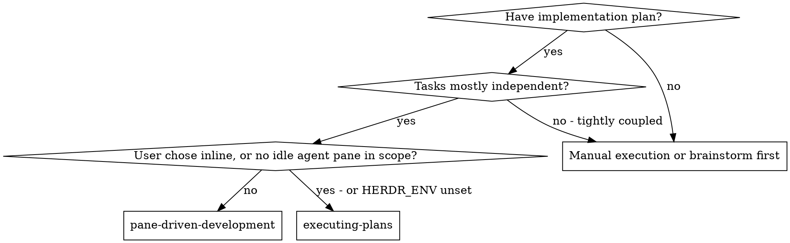

# Pane-Driven Development

**Placeholder resolution:** `<KEY>` placeholders in this file (such as `<BASE_BRANCH>` or `<REPORT_DIRECTORY>`) resolve from the `Herdrpowers Configuration` section of the repository's `CLAUDE.md` / `AGENTS.md`. If that section is missing, initialize it with the pack's init workflow (`/herdrpowers:init` on Claude Code plugin installs; `commands/init.md` otherwise).

## Delegation Model (READ FIRST)

Every task in this skill is delegated to a **herdr sibling agent pane**, never to an in-process subagent — the sole exception is a review task whose resolved mode is `orchestrator`, which the orchestrator runs in a fresh spawned subagent. The `orchestration` skill decides which role takes a task; `using-herdr-sibling-panes` is the transport that submits it and waits for the completion marker. Read both before delegating anything.

Two boundaries override anything below:

- **No in-process subagents.** Wherever this document says "dispatch," read "delegate to an idle sibling pane through `using-herdr-sibling-panes`." Named subagent types are not used by this pack, and the Agent tool is dispatched only for a review task whose resolved mode is `orchestrator`, per "Reviews in `mode: orchestrator`" in `orchestration`.
- **The pane that writes tests owns RED-GREEN-REFACTOR**, and the resolved `test-authoring` / `fix-round-test-authoring` assignments say which pane that is. With `mode: delegate` a separate pane writes them from the task brief alone (see "Parallel test authoring" below); with `mode: implementer` the implementing or fixing pane writes its own per `test-driven-development`. Either way the pane that writes a test produces its RED evidence, and your report names which pane wrote the tests. Review independence itself comes from the *reset session* of each reviewing delegation, not from a named role or a different pane ID, and is never configurable.

Execute the plan by delegating a fresh implementer pane per task, the task's tests per `test-authoring`, a task review (spec compliance + code quality) after each, and a broad whole-branch review at the end.

**Why panes:** a delegated pane starts from a reset session — it never inherits your context or history, so you construct exactly what it needs. That keeps it focused and preserves your own context for coordination work.

**Core principle:** Fresh pane per task + task review (spec + quality) + broad final review = high quality, fast iteration

**Narration:** between tool calls, narrate at most one short line — the ledger and the report files carry the record.

**Continuous execution:** Do not pause to check in with your human partner between tasks. Execute all tasks from the plan without stopping. The only reasons to stop are the four named below, or all tasks complete.

**Rulings, not stalls.** A running plan does not wait on a human. Conflicts,
ambiguities, plan defects, a fix round that ended at the cap — decide them. The
spec is the binding authority, the plan is its argument, and your judgment
settles what neither answers. Record every decision in the ledger as
`Ruling: <what you decided> — <why> — <what it costs if wrong>`, and keep
going. A wrong ruling costs rework your human partner can see and undo; a
session parked on a question costs their whole day and buys nothing.

Four things stop you, and only these: an irreversible or destructive
operation; a security-sensitive action; a side effect outside this worktree
that norms say you ask about first (a merge, a push to a shared branch, a
publish); and a plan so broken that every path forward is a guess. For those,
stop and ask.

**A ruling never rewrites the run's terms.** It resolves what the spec and the
plan left open — it does not raise the five-round cap, re-enable a gate the
repository disabled, disable one it enabled, widen `delegation.pane_scope`, or
touch `.herdrpowers/config.yaml`. Those are the user's declaration, resolved
once at start; a "ruling" that changes one is falsifying the run's terms, not
deciding under them.

## When to Use

**vs. Executing Plans (inline):**
- Fresh pane per task (no context pollution) instead of one session doing every task
- Review after each task (spec compliance + code quality) instead of only at the end
- Costs a fresh session per task and per review; inline costs one session plus one final review
- Both are driven from this pane, share the same plan workspace and ledger, and never pause between tasks
- Requires `HERDR_ENV=1` and at least one idle sibling agent pane inside `delegation.pane_scope` (default: the orchestrator's own tab)

## The Process

Read [references/lifecycle.md](references/lifecycle.md) before starting execution
for the lifecycle map. The steps below require their own references at the
point of use; after compaction, read them from disk again.

## Setup

Ensure the work happens in an isolated workspace: use `using-git-worktrees` to
create one or verify the existing one. Never start implementation on
`<BASE_BRANCH>` (or main/master) without your human partner's explicit consent.

Conversation memory does not survive compaction. In real sessions,
orchestrators that lost their place have re-delegated entire completed task
sequences — the single most expensive failure observed. Track progress in
a ledger file, not only in todos.

- Each plan owns a workspace: at skill start, run this skill's
  `bash scripts/pdd-workspace PLAN_FILE` — it prints the plan's git-ignored
  directory (under `<repo-root>/.herdrpowers/pdd/`), home to
  every artifact for THIS plan: ledger, briefs, reports, review packages.
  Another plan's directory is never yours to read or write.
- Check for this plan's ledger at `<workspace>/progress.md`. If it exists,
  read [references/resuming.md](references/resuming.md) before anything else.
  Resume from its recorded task and fix-round state, never from memory.
- Create the ledger with its identity as the first line:
  `# PDD ledger — plan: <plan file path>`.
- The ledger is your recovery map: the commits it names exist in git even
  when your context no longer remembers creating them. After compaction,
  trust the ledger and `git log` over your own recollection.
- `git clean -fdx` will destroy the workspace (it's git-ignored scratch); if
  that happens, recover from `git log`.

Read the plan once, note its context and Global Constraints, and create a
todo per task. If the plan names a Spec, read that too: the spec is the
authority the plan argues from, and conflicts inside the plan resolve
against it. A plan with no reachable spec gets a ledger note saying so —
rulings made without one are provisional.

Before delegating Task 1, read [references/preflight.md](references/preflight.md)
and perform its conflict scan. Write the table and every ruling to the ledger.

## Delegation Assignments

Before execution, read [references/assignments.md](references/assignments.md)
and resolve every assignment once through `orchestration`. It defines how
disabled gates, test ownership, list roles, escalation, and pane scope shape
this loop. Configuration is input, never changed during a run. Read this
reference again after compaction using the run's already resolved assignments.

## The Task Loop

When the plan lists small, independent edits of the same kind, read
[references/batching.md](references/batching.md) before composing a batch.

Everything you paste into a delegation — and everything a pane prints back —
stays resident in your context for the rest of the session and is re-read on
every later turn. Hand artifacts over as files (see File Handoffs).

**While panes work, you work.** Waiting is not a phase — ledger updates,
packaging the next review, and reading reports all happen while children run.
When you are genuinely idle, wait in bounded stretches and reconcile between
them rather than sitting in one open-ended wait; `using-herdr-sibling-panes`
holds the mechanics.

### 1. Delegate the implementer and the test author

Record BASE (`git rev-parse HEAD`) before delegating — the review package,
the test author's worktree, and fix-round diffs all need it.

Run `bash scripts/task-brief PLAN_FILE N` to extract the task's full text into the
plan workspace. Never make a pane read the whole plan file. Exact values
(numbers, magic strings, signatures, test cases) appear only in the brief.

**The requirements file stays requirements — never append a role contract to
it.** Two panes may read it for the same task, and a file carrying both
"implement this" and "write tests only, never production code" hands each of
them the other's instructions. Each contract goes in its own file beside it,
pointing back at the requirements:

| File | Content | Template |
|---|---|---|
| `task-N-brief.md` | The task's requirements. Written once, read by every pane, appended to by none. | `scripts/task-brief` |
| `task-N-implementer.md` | The implementer contract, pointing at the requirements file. | [implementer-brief.md](implementer-brief.md) |
| `task-N-tests.md` | The test author contract, same pointer. Only when `test-authoring` is delegated. | [test-author-brief.md](test-author-brief.md) |

- If an earlier task parked a finding in the area this task touches, carry
  a pointer to that ledger entry in the delegation.
- Record the pane ID you delegated to — fix rounds 1-3 go back to that pane.

#### Parallel test authoring

Before delegating a test author, read
[references/test-authoring.md](references/test-authoring.md). It owns the
detached BASE worktree, requirements-only input, separate reports, and the
merge-then-run step that produces GREEN. With `mode: implementer`, the
implementer owns RED-GREEN-REFACTOR instead. Name the test writer in the report.

### 2. Handle the report

Read [references/handling-reports.md](references/handling-reports.md) on every
implementer or test-author report. Resolve both statuses before merging tests
and generating the review package. A missing marker or report requires checking
the transport state; it does not by itself mean completion or failure.

### 3. Review the task

Skip only when `assignments.task-review` is disabled; name that in the report.
Otherwise, read [references/task-review.md](references/task-review.md) before
each task review. Supply the requirements, report files, and the BASE..HEAD
review package. Resolve the review assignment through `orchestration`; each
review has a fresh context, and both spec and quality verdicts are required.

### 4. The fix loop

The loop triggers on spec ❌, Critical/Important findings, or a confirmed
⚠️ gap. Read [references/fix-loop.md](references/fix-loop.md) when it triggers
and again **before every round**, even if you read it earlier in this session.
It owns the covering-test handoff, scoped re-review, five-round cap, breaker,
and ledger lines. Five rounds maximum; a ruling cannot raise that cap.

### 5. Complete the task

If any "⚠️ Cannot verify" item remains, read
[references/cannot-verify.md](references/cannot-verify.md) and resolve it before
marking the task complete.

When the review comes back clean — or every open finding is parked with a
ruling at the cap — append the completion line to the ledger in the same
message as your other bookkeeping:

- `Task <N>: complete (commits <base7>..<head7>, review clean)`
- `Task <N>: complete (commits <base7>..<head7>, <K> parked)` after a
  tripped breaker

Then mark the todo complete and move on. Never move to the next task while
the review has open Critical/Important issues that are neither fixed nor
parked-with-ruling at the cap.

## Final Review

When every task is complete, read
[references/final-review.md](references/final-review.md). It covers the
`final-branch-review` gate, its single fix wave, and the finish record.

## Finish

Before finishing or deleting a plan workspace, read the
[finish instructions](references/final-review.md#finish), even when the final
review is disabled. Roll up every `Ruling:`, changed assignment, disabled gate,
and test writer in the final report.

## File Handoffs

Before composing any delegation, read
[references/file-handoffs.md](references/file-handoffs.md). Keep requirements,
role contracts, and concurrent report files separate; submit a one-line
contract pointer with the absolute worktree path and split marker.

## Brief Templates

- [implementer-brief.md](implementer-brief.md) - Implementer pane brief
- [test-author-brief.md](test-author-brief.md) - Test author pane brief, for `test-authoring` / `fix-round-test-authoring` in `mode: delegate`
- [task-reviewer-brief.md](task-reviewer-brief.md) - Task reviewer pane brief (spec compliance + code quality), one per reviewer agent type
- [re-review-brief.md](re-review-brief.md) - Scoped re-review pane brief, one per reviewer agent type per fix round
- Final whole-branch review: use requesting-code-review's [review-brief.md](../requesting-code-review/review-brief.md)

## Common Rationalizations

| Excuse | Reality |
|--------|---------|
| "Close enough on spec compliance" | Reviewer found spec gaps = not done. Fix or hit the cap and adjudicate — those are the only exits. |
| "I'll fix it myself, delegating is overhead" | Orchestrator fixes pollute your context and skip review. Send the findings back to the implementing pane. |
| "One more round will converge" | Past the cap, rounds don't converge — the failure is structural. Adjudicate and route. |
| "The reviewer will just find something new anyway" | Scoped re-reviews verify fixes; they cannot wander. New findings on untouched code go to the ledger, not the loop. |
| "This finding is obviously wrong, I'll drop it" | You adjudicate only at the cap, and every ruling is a ledger entry. Silent discards are forbidden. |
| "The fix was small, skip the re-review" | Unreviewed fixes are how regressions land. Every round ends with a scoped re-review. |
| "Reviews slow the loop down" | The loop without reviews is just unverified churn. Reviews are the loop's brakes and steering. |
| "Ledger bookkeeping is overhead" | The ledger is what survives compaction. Orchestrators without one have re-delegated entire completed task sequences. |
| "The implementing pane is idle — it can review its own work" | Reuse it after a reset-backed submit. Independence is the fresh session, not a different pane ID. Do not review inside the unreset implementing session. |
| "The plan mandates it, so the finding is invalid" | Plan-vs-review conflicts are yours to rule on, with the spec as the binding authority. Record the ruling — a conflict you never ledgered is a decision made in secret. |
| "This call is big enough that I should ask first" | Only the four stop-classes stop you. Everything else is a ruling: decide it, ledger it with what it costs if wrong, and keep going. A session parked on a question costs a whole day and buys nothing. |
| "A delegated pane spun up its own panes — free extra assurance" | A duplicate seat on the same diff; the task review is the gate. Every brief forbids re-delegation, so a pane that did it is a finding to report, not rigor. |
| "I'll turn the gate off in `.herdrpowers/config.yaml` to get past this loop" | The config is the user's declaration, read once at start. Changing it mid-run to escape a review is falsifying the run's terms. Hit the cap and adjudicate. |
| "Task review is disabled, so the pane can review its own work" | Disabling a gate removes the review; it never relaxes independence for the gates still on. |

## Red Flags

**Never:**
- Start implementation on `<BASE_BRANCH>` without explicit user consent
- Use `pane run` to submit work to an agent pane — use `composer-submit.sh`
- Send a delegation without a completion marker, a report-file path, and the absolute worktree path
- Let a delegated pane re-delegate: every brief carries the no-re-delegation clause
- Run two implementation panes against the same worktree
- Make a pane read the whole plan file (hand it its task brief —
  `scripts/task-brief` — instead)
- Skip scene-setting context (the pane needs to understand where the task fits)
- Ignore a pane's questions (answer before letting it proceed)
- Tell a reviewer what not to flag, or pre-rate a finding's severity in the
  brief ("treat it as Minor at most") — the plan's example code is
  a starting point, not evidence that its weaknesses were chosen
- Delegate a task review or re-review without a diff file — generate it first
  (`bash scripts/review-package PLAN_FILE BASE HEAD`) and name the printed path in
  the brief
- Trust "tests pass" without reading the quoted output in the report file
- Re-delegate a task the progress ledger already marks complete — check
  the ledger (and `git log`) after any compaction or resume
- Read or write another plan's workspace directory
- Write `.herdrpowers/config.yaml` from inside a run — it is the user's input, resolved once at start; changing an assignment or a gate is an init-workflow decision
- Finish a run with a disabled gate, a changed assignment, or a ledgered ruling unnamed in the report

**If a pane fails the task:**
- Diagnose with `using-herdr-sibling-panes`' failure table first
- Then re-delegate with what changed — don't fix it yourself (context pollution)
