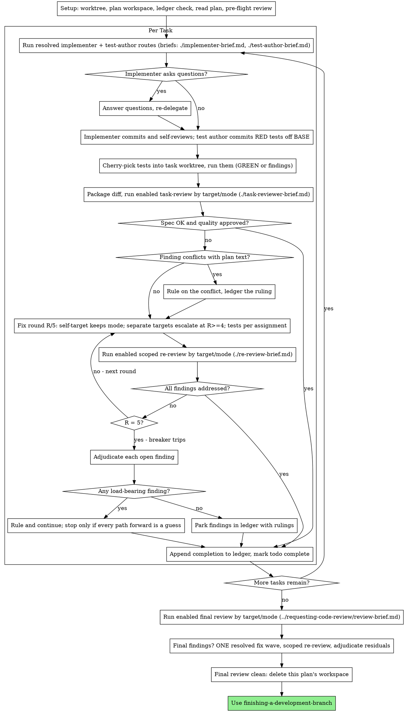

# Lifecycle Map

This reference belongs to `pane-driven-development`. Script paths are relative to the
skill directory (the parent of `references/`), not this directory or the
target repository. Resolve them before invoking a script.

Paths inside diagram labels are relative to the parent skill directory too.

Read the canonical [profiles contract](../../orchestration/references/profiles.md)
before applying this map. Separate delegated targets use reset-backed panes;
selected-profile self-target `delegate` requires fresh subagents, while other
owner-session modes permit reported self-review and optional subagents.
Disabled gates stay off; no-profile independence and the five-round cap remain.

## The Process

