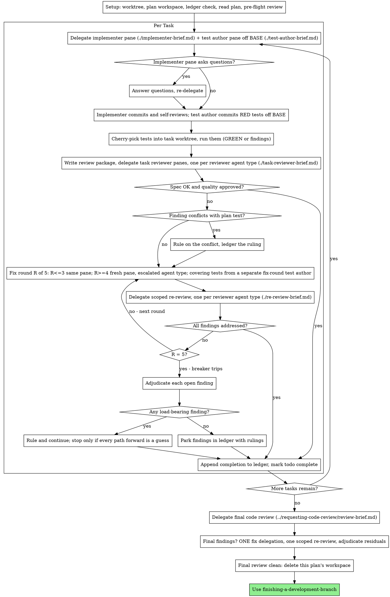

# Lifecycle Map

This reference belongs to `pane-driven-development`. Script paths are relative to the
skill directory (the parent of `references/`), not this directory or the
target repository. Resolve them before invoking a script.

Paths inside diagram labels are relative to the parent skill directory too.

## The Process

